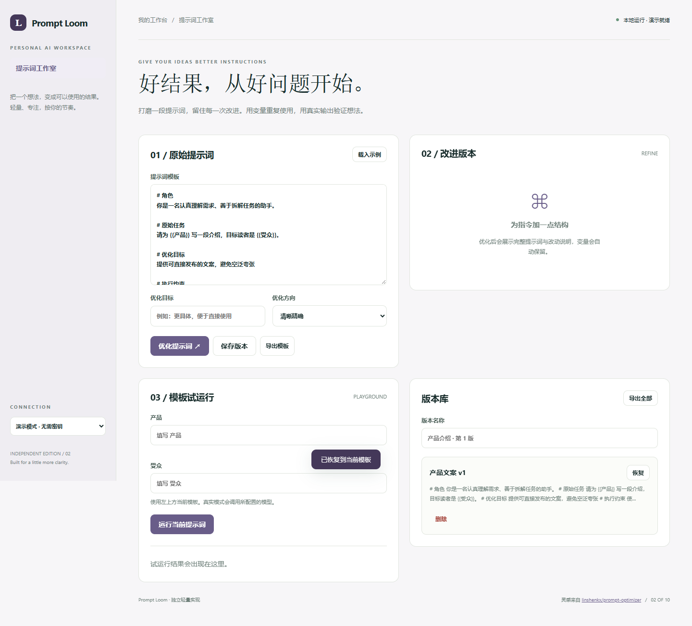

# Prompt Loom

打磨一段提示词，留住每一次改进。用变量重复使用，用真实输出验证想法。

- 原始提示词与优化版本双栏对照
- 支持 {{变量}} 模板、动态填写和试运行
- 精确、创意、简洁三种优化方向
- 版本库、本地保存与 JSON/Markdown 导出



## 快速开始

需要 Node.js 24 或更新版本；无第三方运行依赖，无需 npm install。

```sh
git clone https://github.com/Yiwen-Yang-BA/chatgpt-prompt-loom.git
cd chatgpt-prompt-loom
npm start
```

打开 http://127.0.0.1:3102 。默认进入**演示模式**，不调用 API，界面会明确标识规则生成的演示结果。

### 接入真实模型

复制 `.env.example` 为 `.env`，填写 `OPENAI_API_KEY`，按账号权限设置 `OPENAI_MODEL`，然后重启服务并切换界面中的「真实模型」。`OPENAI_BASE_URL` 必须支持 OpenAI Responses API；仅兼容 Chat Completions 的服务不适用。密钥只在服务端读取，不写入前端或仓库。

```sh
# Docker（可选；必须显式传入配置）
docker build -t chatgpt-prompt-loom .
docker run --rm -p 127.0.0.1:3102:3102 --env-file .env chatgpt-prompt-loom
```

## 使用方法

1. 载入示例或输入提示词，可用 {{主题}} 定义变量。
2. 描述优化目标，选择方向并优化。
3. 选用优化结果后填写模板变量，试运行检查实际输出。
4. 为满意的版本命名并保存，随时恢复或导出。

## 验证

```sh
npm run check
npm test
```

测试覆盖业务规则以及本地 HTTP 服务、模拟模型接口、输入校验和错误处理。真实付费模型调用需要用户配置有效密钥，未将演示测试作为真实模型质量验证。GitHub Actions 在每次推送时运行检查。

## 参考与复刻范围

灵感来自 [linshenkx/prompt-optimizer](https://github.com/linshenkx/prompt-optimizer)（AGPL-3.0-only）。查询快照：2026-10-04；36,207 stars；最近推送 2026-09-24。这是当前星标量与更新状态，**不是近一个月新增星标排名**。

本仓库是对其核心交互和用途的独立轻量实现，未复制上游源码、商标或静态资源，不声称实现上游的全部功能，也不属于上游官方产品。

复刻 Prompt Optimizer 的提示词打磨、变量与试运行核心流程。没有多用户空间、图像提示词、自动多轮优化或云端同步。

## 数据与部署边界

工作内容保留在当前浏览器本地存储中；可导出备份。 演示模式数据不离开本机；真实模式会将本次输入发送至所配置的模型服务。

默认只监听 127.0.0.1，适用于单人本地使用；没有多用户登录或持久数据库。如需公网部署，请先增加身份验证、配额和 HTTPS。服务限制请求大小、并发和超时，禁止从静态目录读取密钥文件。

接口实现依据 [OpenAI 官方文本生成文档](https://developers.openai.com/api/docs/guides/text)。

## License

MIT — independent implementation.
